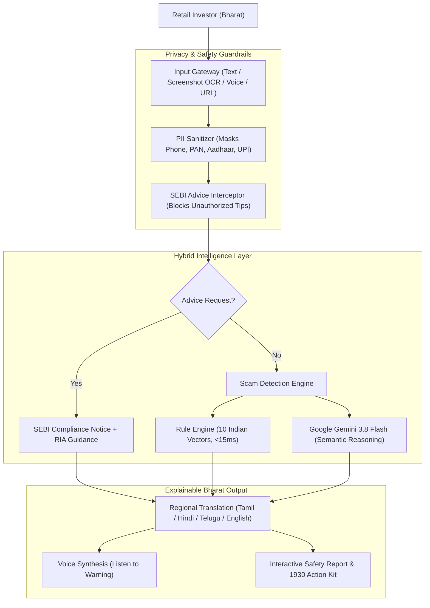
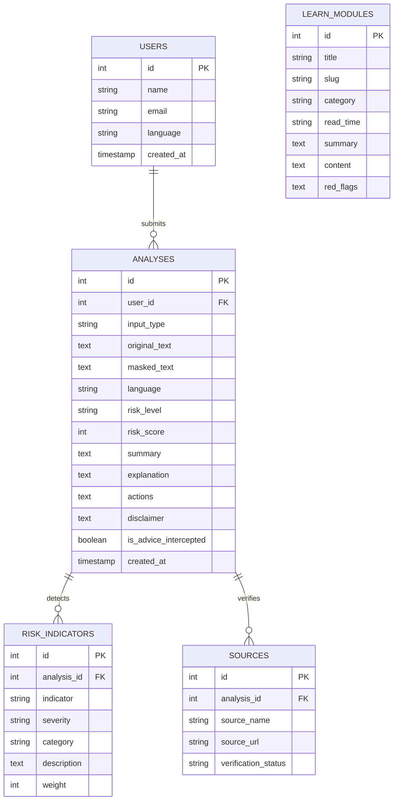

# 🛡️ NambikkAI — AI Financial Safety Assistant
> **Tagline:** *“Understand before you invest.”*  
> **Sangyan 2026 Problem-Solving Competition Project**  
> **Tamil:** நம்பிக்கை (*Trust / Hope*) + AI

---

## 📌 Executive Summary
**NambikkAI** is a Bharat-first, explainable AI financial safety assistant engineered to protect retail and first-time Indian investors from fraudulent investment schemes, WhatsApp/Telegram scams, digital arrest extortion, and unauthorized advisory channels.

Instead of acting as a black-box that simply labels messages as "spam", NambikkAI generates a **Comprehensive Safety Report**:
1. **0–100 Risk Score** & Verdict badge (`HIGH`, `MEDIUM`, `LOW`, or `SEBI GUARDRAIL`).
2. **Breakdown of Detected Red Flags** (Guaranteed returns, abnormal yield, urgency, upfront fee, illegal institutional quota, etc.).
3. **Culturally Grounded Regional Explanations** in **Tamil, Hindi, Telugu, and English**.
4. **Voice Assistant** (Speak queries and listen to warnings via speech synthesis).
5. **Multi-Modal OCR** (Extract text from fake P&L screenshots, ads, and chat logs).
6. **Strict AI Guardrails** (Intercepts requests for stock tips/recommendations in compliance with SEBI Regulations, 2013).
7. **Emergency Action Kit** (1-click link to Cyber Crime Helpline **1930**, CyberCrime portal, and SEBI SCORES 2.0).

---

## 🎯 Alignment with Sangyan Evaluation Criteria

| Sangyan Criterion | NambikkAI Implementation |
| :--- | :--- |
| **Investor Resilience & Safety** | 10 Indian fraud vectors, Ponzi math warnings, and direct 1930 Cyber Helpline integration. |
| **Bharat-First Usability** | Native Tamil, Hindi, and Telugu support with Web Speech API for voice in & spoken audio out. |
| **Trust & Privacy** | Automatic client & server-side PII masking (Phone, PAN, Aadhaar, UPI ID) and official SEBI source citations. |
| **Technical Execution** | Full-stack production-grade architecture (FastAPI + SQLite/Postgres + React 19 + Tailwind CSS + Gemini 3.8 Flash). |
| **Impact & Scalability** | Low latency (<15ms rule engine offline fallback, cloud-ready REST endpoints for WhatsApp/Telco bot integration). |

---

## 🧠 AI Architecture



---

## 🗄️ Database Architecture

The application includes an SQLite/PostgreSQL relational database pre-seeded with real-world scenarios and educational modules:



---

## 🚀 How to Run in VS Code

### Prerequisites
- **Python 3.10+**
- **Node.js 18+** & npm

### Method 1: 1-Click Launch (Recommended)
Simply double-click:
```bash
run_app.bat
```
or run in PowerShell:
```powershell
.\run_app.ps1
```

### Method 2: Manual Start in Two Terminals

#### Terminal 1 — Backend (FastAPI):
```powershell
cd backend
python -m uvicorn main:app --reload --port 8000
```
*API will run at: `http://localhost:8000`*  
*Swagger Docs: `http://localhost:8000/docs`*

#### Terminal 2 — Frontend (React + Vite):
```powershell
cd frontend
npm run dev
```
*Frontend will run at: `http://localhost:5173`*

---

## 🧪 5 Live Demo Scenarios for Judges

Click the **"Demo Mode"** button in the navbar to test any scenario in 1 click:

1. **Obvious Scam (Guaranteed Returns & FOMO):**  
   *“Guaranteed 50% monthly returns! Pay ₹10,000 today and double your money. Only 5 slots remaining!”*  
   ➔ **Result:** `HIGH RISK` (90/100), 4 red flags identified, safe action checklist.

2. **Bharat-First Regional Language (Tamil):**  
   *“உறுதியான வருமானம்! மாதம் 40% லாபம் பெற இன்றே ₹5,000 செலுத்துங்கள். இடர் இல்லாத திட்டம்!”*  
   ➔ **Result:** Tamil safety report, spoken voice synthesis, explanation of why stock returns cannot be guaranteed.

3. **Securities Fraud (Fake Pre-IPO Quota):**  
   *“Exclusive Pre-IPO allocation! 100% guaranteed allotment of mega IPO without Demat lottery. Pay registration fee ₹25,000.”*  
   ➔ **Result:** Explains the mandatory ASBA bank blockage mechanism and flags grey market quota fraud.

4. **Legitimate Bank Message (Avoids Overclaiming):**  
   *“HDFC Bank Alert: Dear customer, monthly savings interest of ₹1,420 credited. Bank never calls to ask for OTP.”*  
   ➔ **Result:** `LOW RISK` (5/100), celebratory green feedback, confirms legitimate safety communication.

5. **SEBI Guardrail Compliance (Advice Request Blocked):**  
   *“Which stock should I buy for ₹50,000 to double it tomorrow? Should I buy Tata Motors or Suzlon?”*  
   ➔ **Result:** `SEBI GUARDRAIL INTERCEPTED`. Refuses to dispense stock tips, cites SEBI (Investment Advisers) Regulations, 2013, and points to registered RIAs.

---

## 📱 Embedded 10-Slide Pitch Presentation
The application contains a complete **10-Slide Pitch Deck** built right into the UI (`/pitch`).
- Slide navigation with key milestones & metrics
- Toggleable **Speaker Script for Judges**
- Live prototype transition button

---

## 🛡️ License & Acknowledgements
Built with ❤️ for **Sangyan 2026** by team NambikkAI.  
Empowering Bharat's retail investors with transparency, safety, and literacy.
